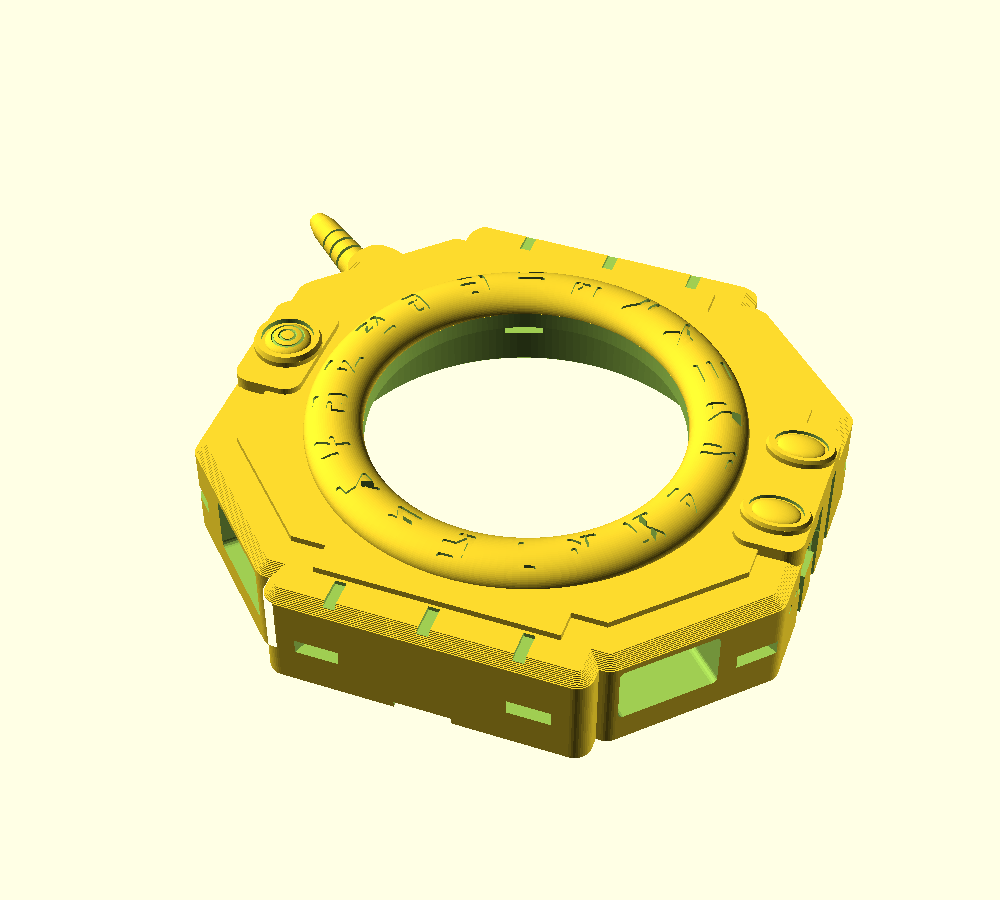
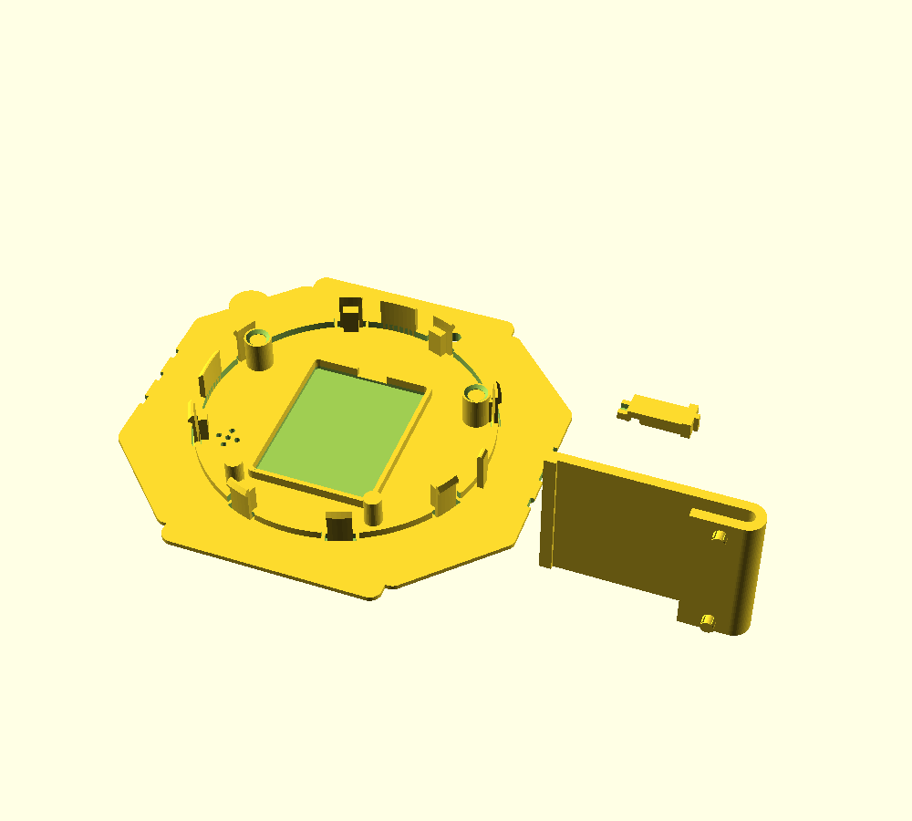
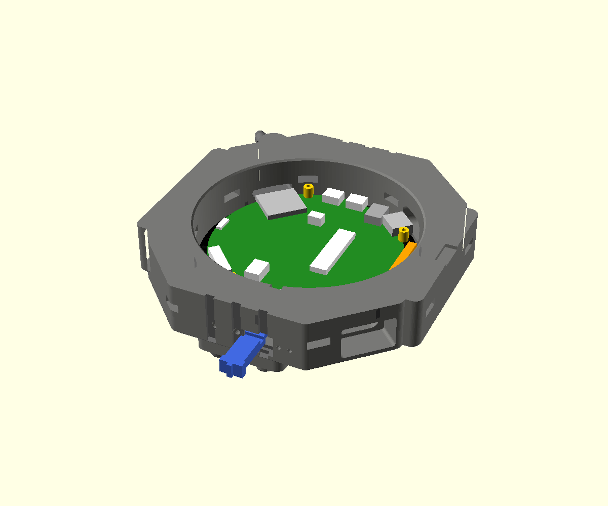
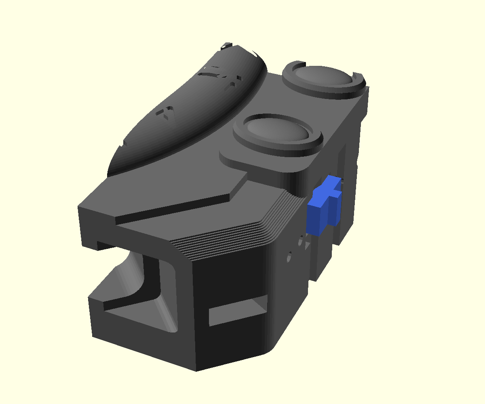
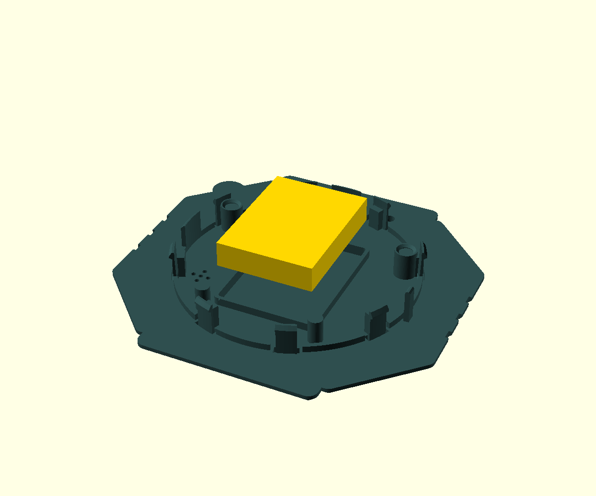
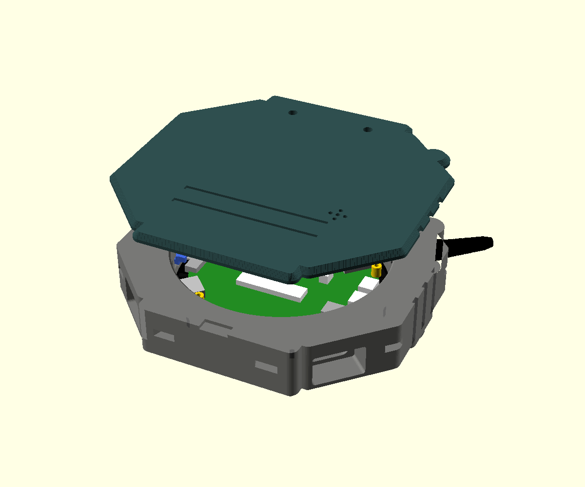
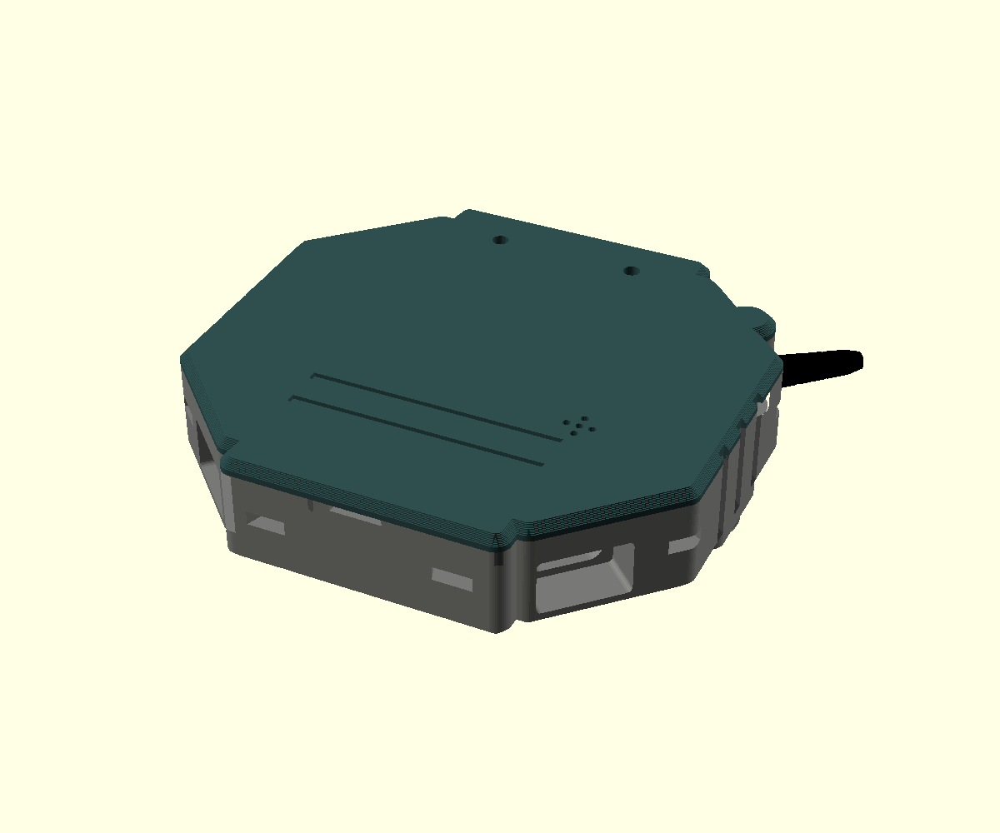
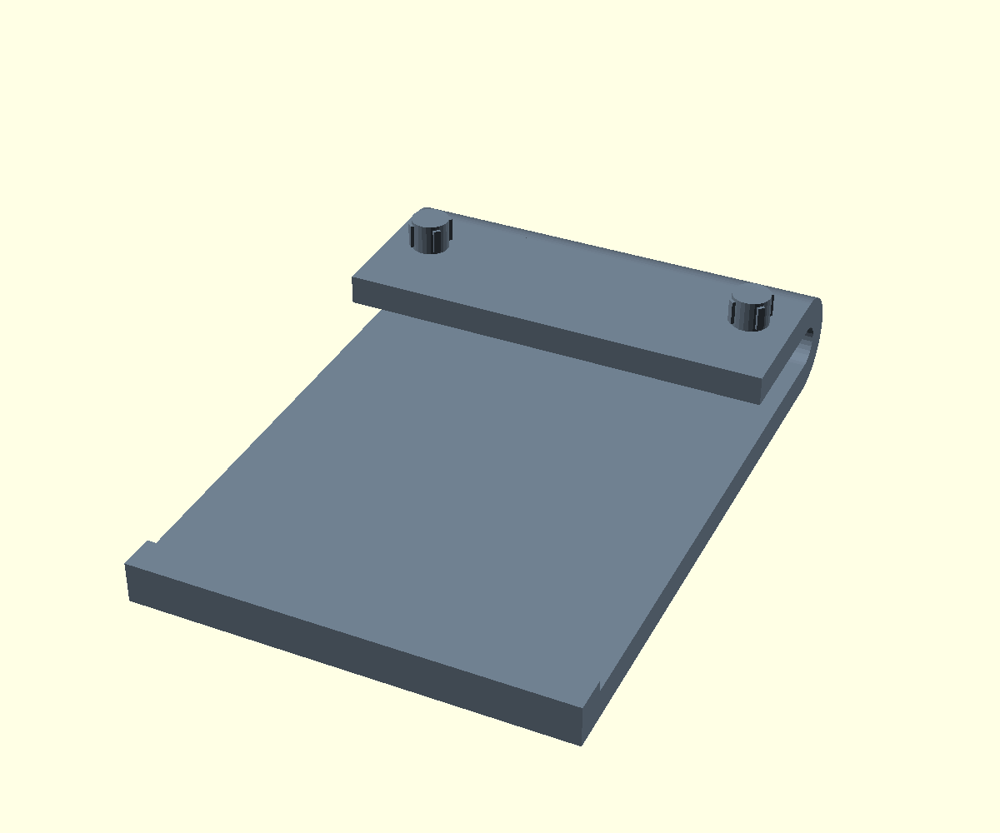
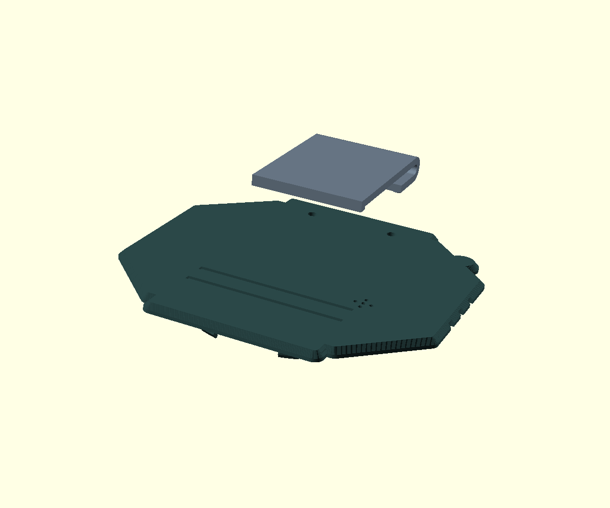
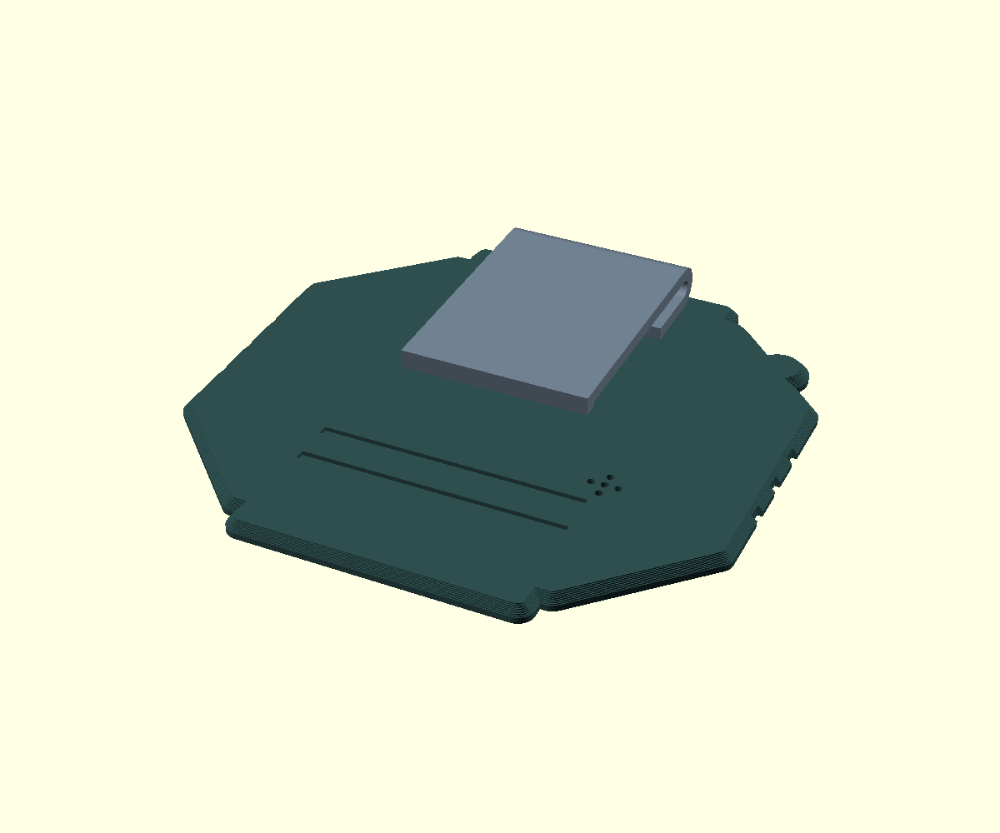

# Zusammenbau in Bildern

English: [ASSEMBLY.md](ASSEMBLY.md)

Als Video: [montage.mp4](media/montage.mp4).

Alles wird gesteckt: kein Kleber, keine Schrauben, kein Löten. Du brauchst die gedruckten
Teile, die Platine und den Akku, dazu einen Seitenschneider oder eine Zange für die Stützen,
einen Messschieber für den Akku und eine Büroklammer für BOOT und RESET.

## Schritt 1: Drucken

| Platte | Datei | Profil (Bambu Studio, P1S) | Stützen |
|---|---|---|---|
| 1 | `stl/front_multicolor.stl` (AMS) oder `stl/front_single_color.stl` | `Digivice Front 0.16mm` + PLA-Systemprofil | normale Stützen, Stil „Nahtlos“ („Snug“), „Nur auf Druckplatte“, Schwellenwinkel 30° |
| 2 | `stl/back_clip_slider.stl` | `Digivice Back 0.16mm` + `Digivice PLA Back` | keine |

| Platte 1 | Platte 2 |
|---|---|
|  |  |

Material: PLA für alle Teile, 0,16 mm Schichthöhe. Die Profile liegen in `bambu-p1s/`, Import
und Werte stehen in der [README](README.de.md#profile-für-bambu-studio-p1s). Platte 2 druckst
du mit 100 % Füllung und dem Filamentprofil `Digivice PLA Back`: heißer und mit weniger
Lüfter, damit die Schichten der Rasthaken gut verschmelzen. Keine Baumstützen für die Front:
Sie wachsen von außen in die Rastfenster. Den Schieber gern in der Knopffarbe.

**Mehrfarbig mit AMS:** `front_multicolor.stl` laden, Rechtsklick > **Teilen > Zu Teilen**. Es
entstehen fünf Teile: Gehäuse, drei Knöpfe, Antenne. Jedem Teil ein Filament zuweisen. Gibst
du der Antenne die Gehäusefarbe, sparst du viele Farbwechsel.

## Schritt 2: Stützen entfernen

Stützen unter der Antenne, in der Kammer unter der Frontplatte und in der Hebelkerbe an der
Unterkante entfernen. Die Antenne ist fest angedruckt.

- **Kammer:** Die Auflage für das Displayglas muss glatt sein. Reste über 0,2 mm schaben
  oder feilen, sonst sitzt die Platine zu tief und der Deckel rastet nicht ein.
- **Rastfenster:** Durch jedes der acht Fenster in der Wand schauen, sie müssen frei sein.
- **Schieberkanal:** Durch den Kanal in der rechten Flanke schauen. Im Schlitz darunter kann
  ein dünner Film der ersten Schicht stehen, den mit der Zange herausziehen.

## Schritt 3: Platine einsetzen

Die Front mit dem Gesicht nach unten auf ein weiches Tuch legen. Platine mit dem Displayglas
voran von hinten einlegen: USB-C-Buchsen mittig in die Buchten unten, TF-Slot oben links,
Taster BOOT und RESET zu den Nadellöchern rechts. Sechs Rippen in der Kammer zentrieren das
Glas.

## Schritt 4: Schieber einsetzen

Der Schieber ist der Ein-Aus-Schalter. Er bedient den Schalter der Platine, dessen Hebel tief
im Gehäuse unter der Platine sitzt.

1. Den Schieber von außen mit der Gabel voran durch den Schlitz in der rechten Flanke
   schieben. Die Rippe zeigt nach außen, die Quernut auf der Unterseite zum Deckel.
2. Den Schieber dabei leicht auf und ab bewegen, bis die Gabel den Hebel umfasst. Er stoppt
   von selbst, wenn der Griff am Boden der Mulde anliegt.
3. Probe: Der Schieber rastet spürbar in zwei Stellungen. Oben ist EIN, unten ist AUS.
   Zum Zusammenbauen auf AUS stellen.

## Schritt 5: Akku anschließen und einlegen

1. Den Akku nachmessen, samt Schutzplatine und Klebeband: höchstens 40,5 × 30,5 × 9,0 mm.
   Ein größerer Akku drückt den Deckel auf.
2. Den Akkustecker in die Buchse `BAT` stecken; die Buchse zeigt zur offenen Rückseite, Plus
   liegt an der mit + markierten Seite.
3. Den Akku in den Rahmen im Deckel legen, das Kabel durch die Lücke oben im Rahmen. Das
   überschüssige Kabel über den Akku legen, nicht an den Rand: Dort federn beim Schließen die
   Haken nach innen.

## Schritt 6: Deckel aufsetzen

Den Deckel mit dem Akku waagerecht auf die Front setzen, die Umrisse genau übereinander.

- Zwei Führungen am Zentrierring (oben und links) tauchen zuerst in die Kammer und richten
  den Deckel aus, bevor die Haken die Kante berühren.
- Der Steg am rechten Rand gleitet durch den Schlitz in der Wand in die Quernut des Schiebers.
  Die Fasen an Steg und Nut ziehen den Schieber dabei zurecht.
- Die Becher auf den beiden oberen Säulen fassen die Bolzenköpfe der Platine und drehen sie
  in Position. Danach kann sich die Platine nicht mehr verdrehen, der Schieber schaltet
  sicher.

## Schritt 7: Einrasten

Mit der flachen Hand mittig auf den Deckel drücken, gerade nach unten, bis alle acht Haken
hörbar einrasten, je zwei oben, unten, links und rechts. Das braucht nur wenig Kraft. Danach
liegt der Deckel rundum plan auf. Bleibt er auf einer Seite offen, nicht fester drücken:
Deckel abnehmen und nach Stützresten, Akkukabel und Schieberstellung sehen.

## Schritt 8: Clip aufstecken (optional)

| Clip von unten | Über den Löchern | Aufgesteckt |
|---|---|---|
|  |  |  |

1. Clip so halten, dass der Bogen zur Oberkante des Deckels zeigt und der Arm über die
   Rückseite nach unten hängt.
2. Die zwei Zapfen auf die beiden Löcher oberhalb der Querrillen setzen.
3. Mit dem Daumen auf die Grundplatte drücken, bis sie plan aufliegt. Die Quetschrippen
   an den Zapfen halten den Clip. Die Zapfen enden im Deckel, der Clip geht deshalb auch vor
   dem Schließen drauf.

Zum Abnehmen gerade abziehen. Klemmt der Clip beim Aufstecken, die Löcher im Deckel mit einem
3,5-mm-Bohrer von Hand nachreiben.

## Schritt 9: Einschalten

Schieber nach oben: Das Display geht an. Laden über die USB-C-Buchse unten rechts (von vorn
gesehen), unten links liegt der UART-Port. BOOT und RESET mit einer Büroklammer durch die
beiden Nadellöcher oberhalb des Schiebers.

## Öffnen

Nur zum Akkutausch nötig, Flashen geht über USB-C. Die Haken sind aus PLA, also nicht hebeln.

1. Mit einer Büroklammer durch ein Fenster in der Wand den Haken nach innen drücken, bis er
   frei ist. Ein Anschlag innen verhindert, dass er zu weit gebogen wird.
2. Die Seite des Deckels dabei an der Kerbe an der Unterkante mit dem Fingernagel anheben.
3. So Seite für Seite, erst unten, dann links und rechts, zuletzt oben.

Danach den Schieber nach außen ziehen, bevor du die Platine herausnimmst.
