# Zusammenbau in Bildern

English: [ASSEMBLY.md](ASSEMBLY.md)

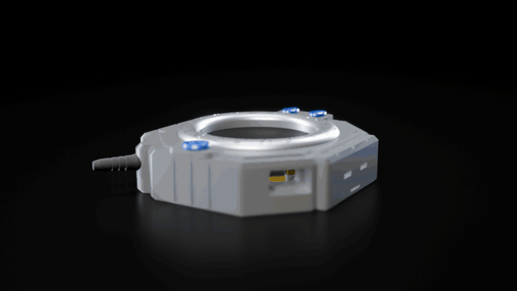

Als Video: [montage.mp4](media/montage.mp4).

Alles wird gesteckt: kein Kleber, keine Schrauben, kein Löten. Du brauchst die gedruckten
Teile, die Platine und den Akku, dazu einen Seitenschneider oder eine Zange für die Stützen
und eine Büroklammer für BOOT und RESET.

## Schritt 1: Drucken

| Platte | Datei | Profil (Bambu Studio, P1S) | Stützen |
|---|---|---|---|
| 1 | `stl/front_multicolor.stl` (AMS) oder `stl/front_single_color.stl` | `Digivice Front 0.16mm` + PLA-Systemprofil | normale Stützen, „Nur auf Druckplatte“, Schwellenwinkel 30° |
| 2 | `stl/back_clip_slider.stl` | `Digivice Back 0.16mm` + `Digivice PLA Back` | keine (Clip: optional, siehe unten) |

| Platte 1 | Platte 2 |
|---|---|
|  |  |

Material: PLA für alle Teile, 0,16 mm Schichthöhe. Die Profile liegen in `bambu-p1s/`, Import
und Werte stehen in der [README](README.de.md#profile-für-bambu-studio-p1s). Platte 2 druckst
du mit dem Filamentprofil `Digivice PLA Back`: heißer und mit weniger Lüfter, damit die
Schichten der Rasthaken gut verschmelzen. Keine Baumstützen für die Front: Sie wachsen in die
Rastfenster. Den Schieber gern in der Knopffarbe.

Bei Platte 2 warnt Bambu Studio vor „schwebenden Regionen“. Die liegen am Clip: Sein Arm
beginnt 6 mm über der Platte, und die Zapfen stehen seitlich ab. Deckel und Schieber brauchen
keine Stützen. Wie der Clip eigene Stützen und bei Bedarf einen Rand bekommt, steht in der
README.

**Mehrfarbig mit AMS:** `front_multicolor.stl` laden, Rechtsklick > **Teilen > Zu Teilen**. Es
entstehen fünf Teile: Gehäuse, drei Knöpfe, Antenne. Jedem Teil ein Filament zuweisen. Gibst
du der Antenne die Gehäusefarbe, sparst du viele Farbwechsel.

## Schritt 2: Stützen entfernen

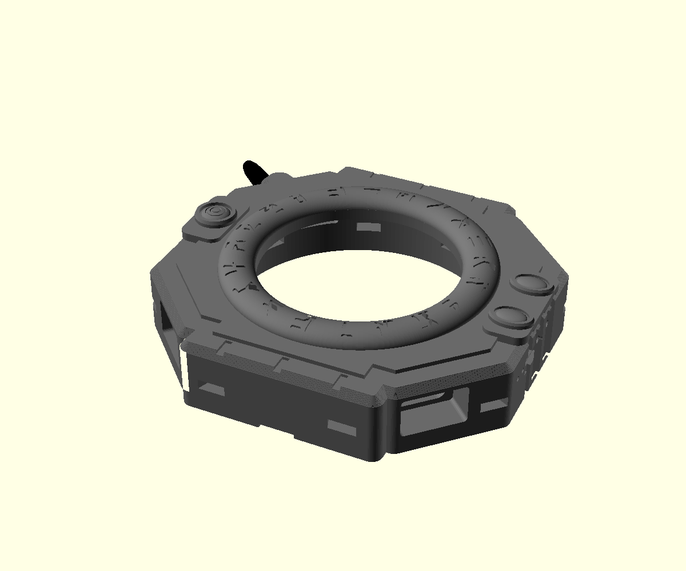

Stützen unter der Antenne, in der Kammer unter der Frontplatte und in der Hebelkerbe an der
Unterkante entfernen. Die Kammer muss glatt sein, dort liegt später das Displayglas an. Die
acht Rastfenster in der Wand müssen frei sein, sonst rasten die Haken nicht ein. Die Antenne
ist fest angedruckt.

## Schritt 3: Akku einlegen

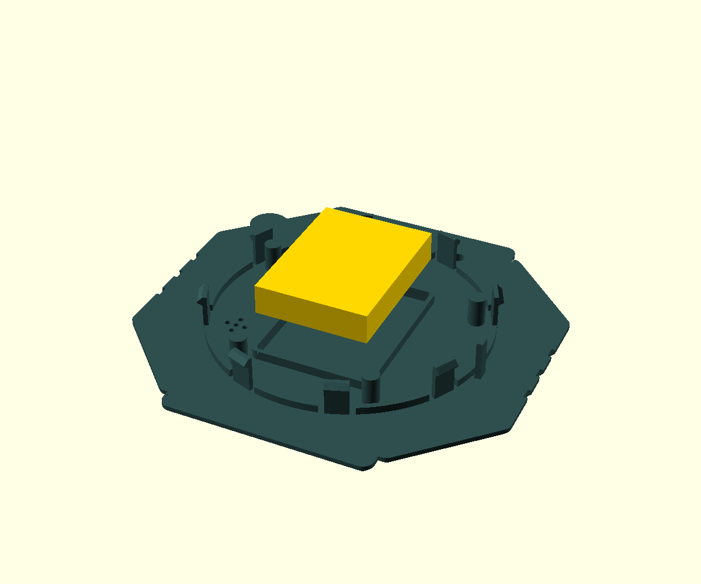

Akku in den Rahmen im Deckel legen, das Kabel mit dem Stecker durch die Lücke oben im Rahmen
führen. Der Akku wird später von der Platine gehalten.

## Schritt 4: Clip aufstecken (optional)

| Clip von unten | Über den Löchern | Aufgesteckt |
|---|---|---|
| 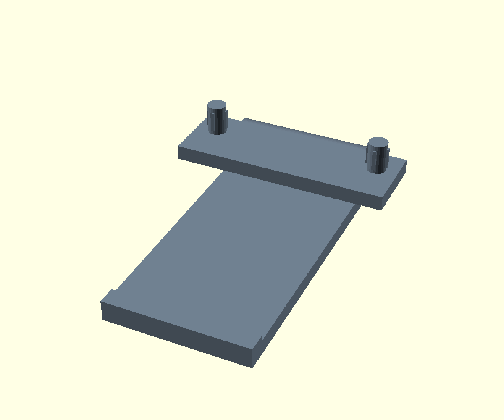 | 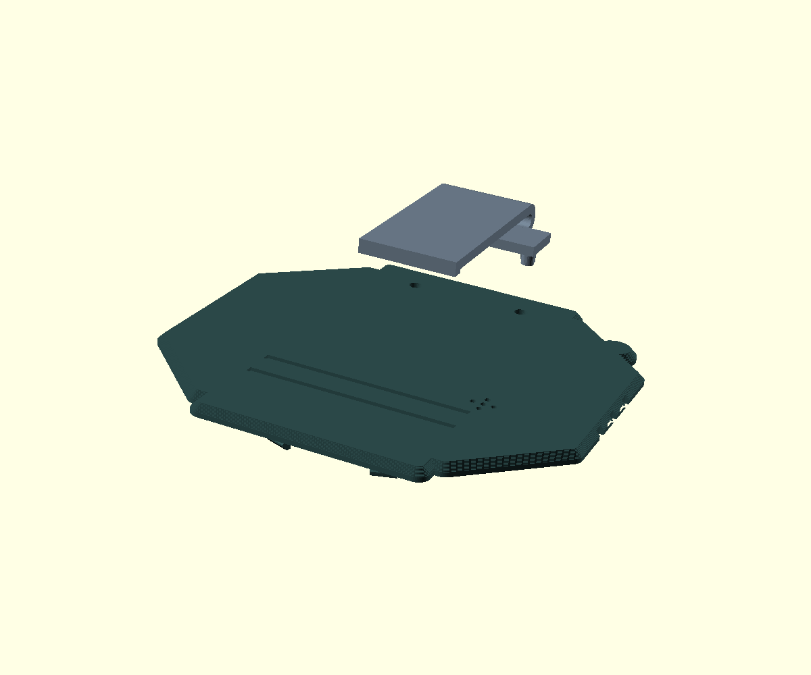 | 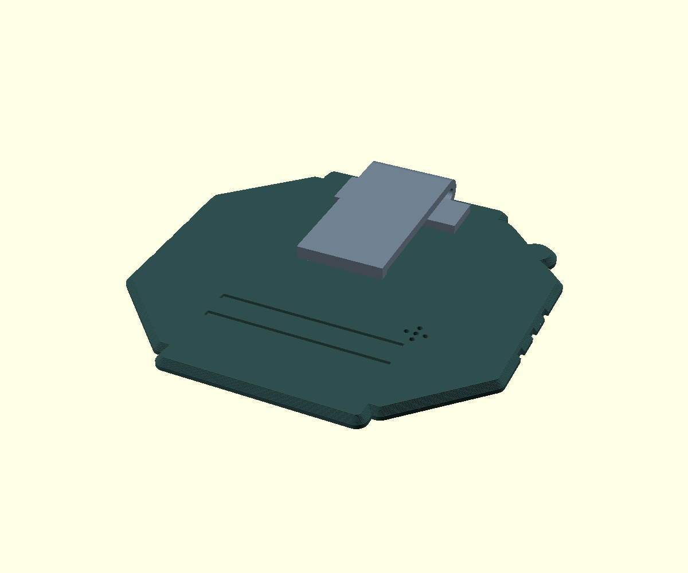 |

1. Clip so halten, dass der Bogen zur Oberkante des Deckels zeigt und der Arm über die
   Rückseite nach unten hängt.
2. Die zwei Zapfen auf die beiden Löcher oberhalb der Querrillen setzen.
3. Mit dem Daumen auf die Grundplatte drücken, bis sie plan aufliegt. Die Quetschrippen an
   den Zapfen halten den Clip.

Zum Abnehmen gerade abziehen.

## Schritt 5: Platine einsetzen

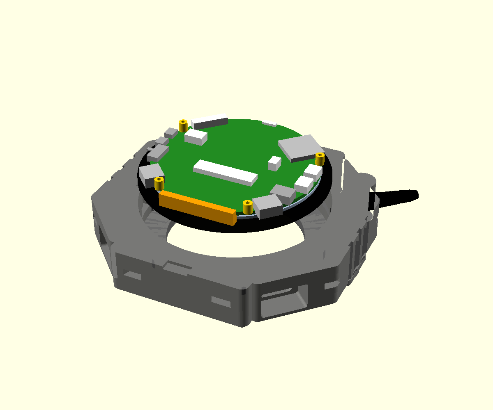

Akkustecker in die Buchse `BAT` stecken, Plus liegt an der mit + markierten Seite. Platine mit
dem Displayglas voran von hinten in die Front legen: USB-C-Buchsen in die Buchten unten,
TF-Slot nach oben links, Taster BOOT und RESET zu den Nadellöchern rechts.

## Schritt 6: Schieber einsetzen

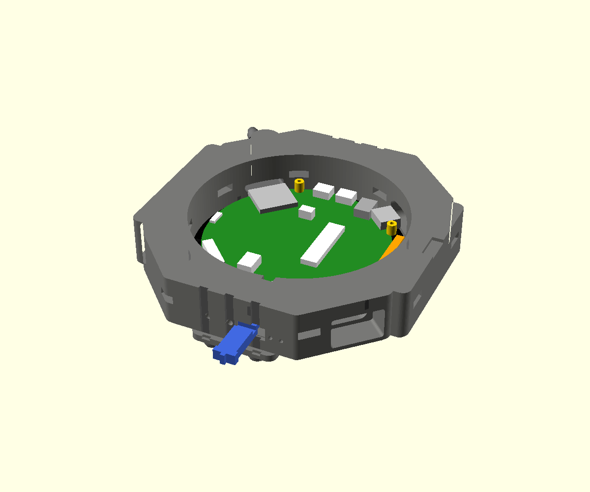

Der Schieber ist der Ein-Aus-Schalter. Er bedient den Schalter der Platine, dessen Hebel tief
im Gehäuse unter der Platine sitzt.

1. Den Schieber von außen mit der Gabel voran durch den Schlitz in der rechten Flanke
   schieben. Die Rippe zeigt nach außen, die Quernut auf der Unterseite zum Deckel.
2. Den Schieber dabei leicht auf und ab bewegen, bis die Gabel den Hebel umfasst und der Griff
   in der Mulde liegt.
3. Probe: Der Schieber rastet spürbar in zwei Stellungen. Oben ist EIN, unten ist AUS.

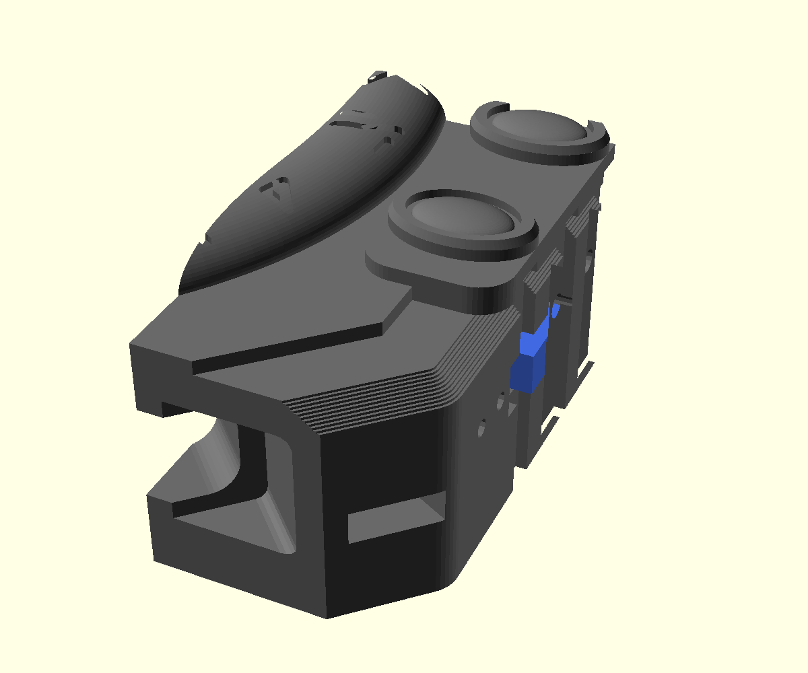

## Schritt 7: Deckel aufsetzen

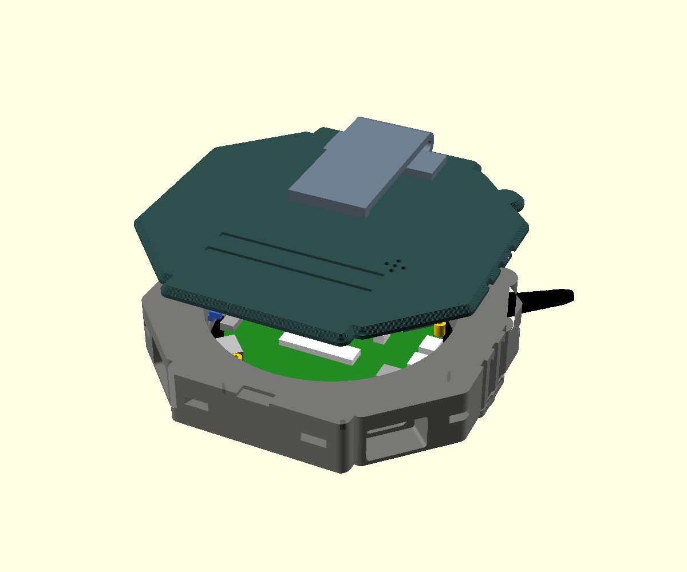

Deckel mit Akku und Clip auf die Front setzen, die Umrisse genau übereinander: Dann treffen
die acht Haken ihre Fenster. Die vier flachen Säulen im Deckel stehen knapp hinter den Bolzen
der Platine und halten sie in der Kammer. Der Steg am rechten Rand des Deckels gleitet durch
den Schlitz in der Wand in die Quernut des Schiebers und hält ihn fest; dafür muss der
Schieber ganz im Kanal stecken.

## Schritt 8: Einrasten

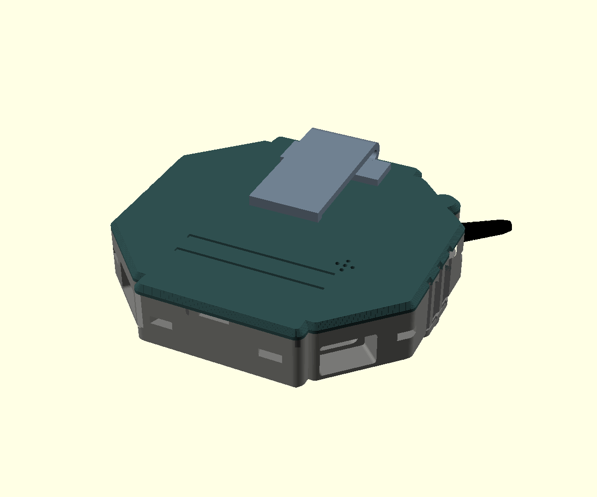

Die Front mit dem Gesicht nach unten auf ein weiches Tuch legen. Den Deckel Seite für Seite
mit beiden Daumen andrücken, bis alle acht Haken hörbar einrasten, je zwei oben, unten, links
und rechts. Seite für Seite geht leichter als alle acht auf einmal. Danach liegt der Deckel
rundum plan auf.

## Schritt 9: Einschalten

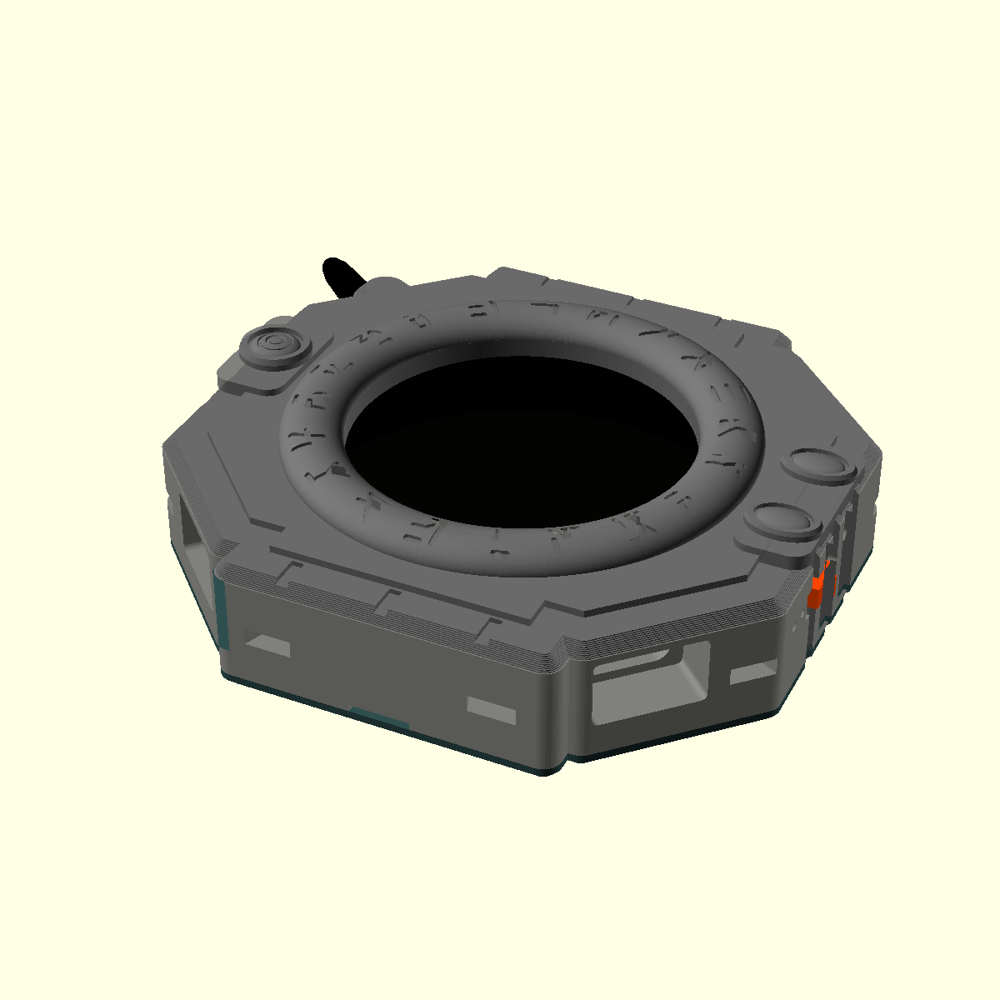

Schieber nach oben: Das Display geht an. Laden über die USB-C-Buchse unten rechts (von vorn
gesehen), unten links liegt der UART-Port. BOOT und RESET mit einer Büroklammer durch die
beiden Nadellöcher oberhalb des Schiebers.

## Öffnen

Die Haken sind aus PLA, also nicht mit Gewalt hebeln. Mit einer Büroklammer durch die acht
Fenster in der Wand die Haken einzeln nach innen drücken und den Deckel dabei an der Kerbe an
der Unterkante mit einer Münze oder dem Fingernagel anheben, Seite für Seite. Danach den
Schieber nach außen ziehen, bevor du die Platine herausnimmst.
