# Assembly in Pictures

Deutsch: [ANLEITUNG.md](ANLEITUNG.md)

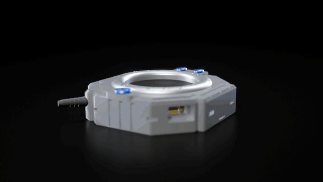

As a video: [montage_en.mp4](media/montage_en.mp4).

Everything snaps or plugs together: no glue, no screws, no soldering. You need the printed
parts, the board and the battery, plus side cutters or pliers for the supports, a caliper for
the battery and a paper clip for BOOT and RESET.

## Step 1: Print

| Plate | File | Profile (Bambu Studio, P1S) | Supports |
|---|---|---|---|
| 1 | `stl/front_multicolor.stl` (AMS) or `stl/front_single_color.stl` | `Digivice Front 0.16mm` + a PLA system profile | Normal supports, style “Snug”, on build plate only, threshold angle 30° |
| 2 | `stl/back_clip_slider.stl` | `Digivice Back 0.16mm` + `Digivice PLA Back` | None |

| Plate 1 | Plate 2 |
|---|---|
| 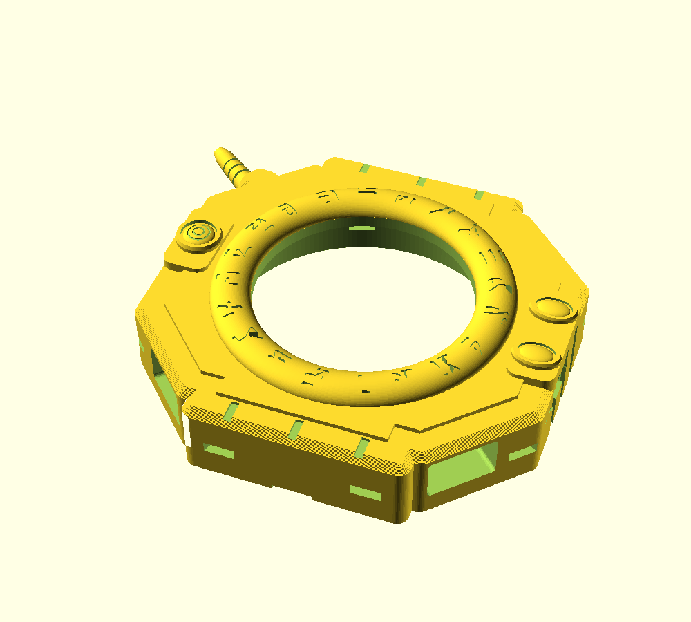 | 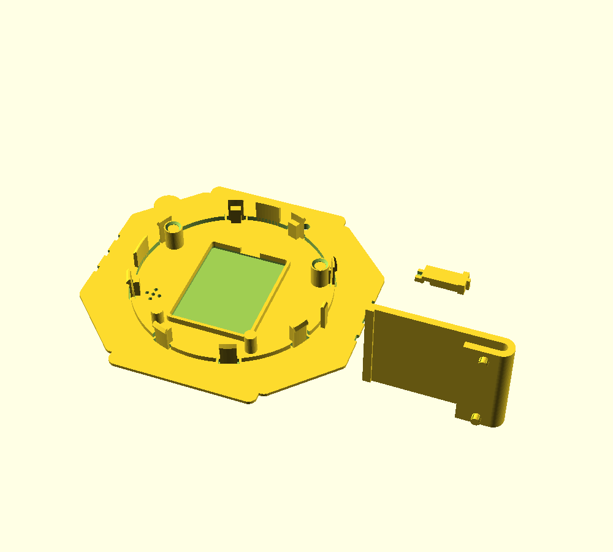 |

Material: PLA for all parts, 0.16 mm layer height. The profiles are in `bambu-p1s/`; the
[README](README.md#profiles-for-bambu-studio-p1s) explains how to import them and lists their
settings. Print plate 2 with 100% infill and the filament profile `Digivice PLA Back`: it runs
hotter and with less cooling, so the layers of the snap hooks fuse well. No tree supports for
the front: they grow into the snap windows from outside. The slider looks good in the button
color.

**Multicolor with AMS:** load `front_multicolor.stl`, right-click it and choose **Split > To
parts**. You get five parts: body, three buttons, antenna. Assign a filament to each part. If
you give the antenna the body color, you save many color changes.

## Step 2: Remove the Supports

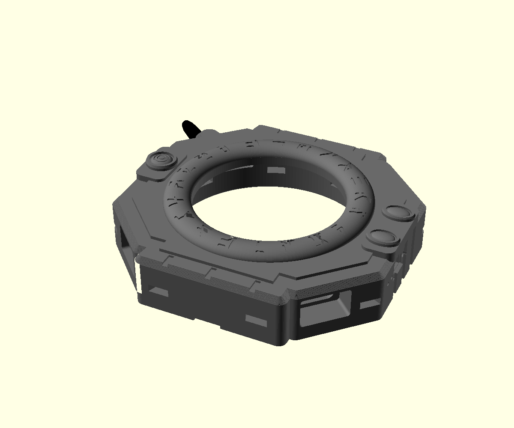

Remove the supports under the antenna, in the chamber under the front plate and in the pry
notch at the bottom edge. The antenna is printed onto the front and stays attached.

- **Chamber:** the ledge for the display glass must be smooth. Scrape or file off any
  leftovers taller than 0.2 mm, or the board sits too deep and the back cover will not snap
  in.
- **Snap windows:** look through each of the eight windows in the wall; they must be clear.
- **Slider channel:** look through the channel in the right flank. A thin film of the first
  layer may cover the slot below it; pull it out with the pliers.

## Step 3: Insert the Board

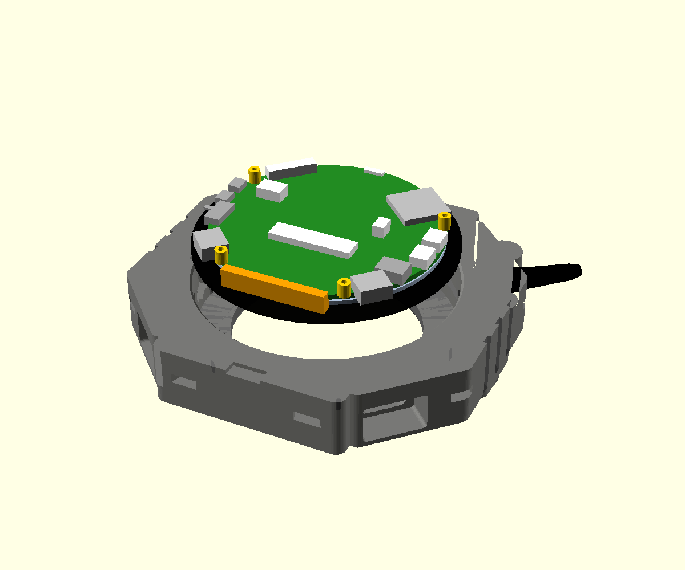

Lay the front face down on a soft cloth. Insert the board from behind, display glass first:
USB-C sockets centered in the bays at the bottom, TF slot at the top left, BOOT and RESET
buttons toward the pinholes on the right. Six ribs in the chamber center the glass.

## Step 4: Insert the Slider

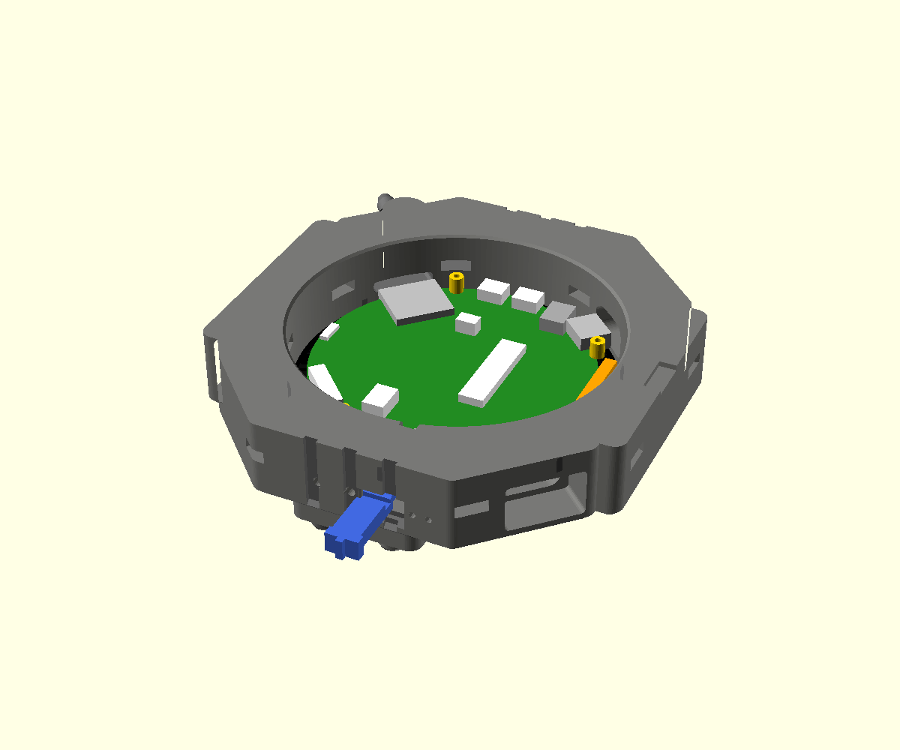

The slider is the on/off switch. It moves the board’s own switch, whose lever sits deep in the
case under the board.

1. From outside, push the slider, fork first, through the slot in the right flank. The rib
   faces outward; the cross groove on the underside faces the back cover.
2. While pushing, move the slider up and down slightly until the fork straddles the lever. It
   stops by itself when the grip rests against the bottom of the recess.
3. Check: you can feel the slider click into two positions. Up is ON, down is OFF. Set it to
   OFF for assembly.

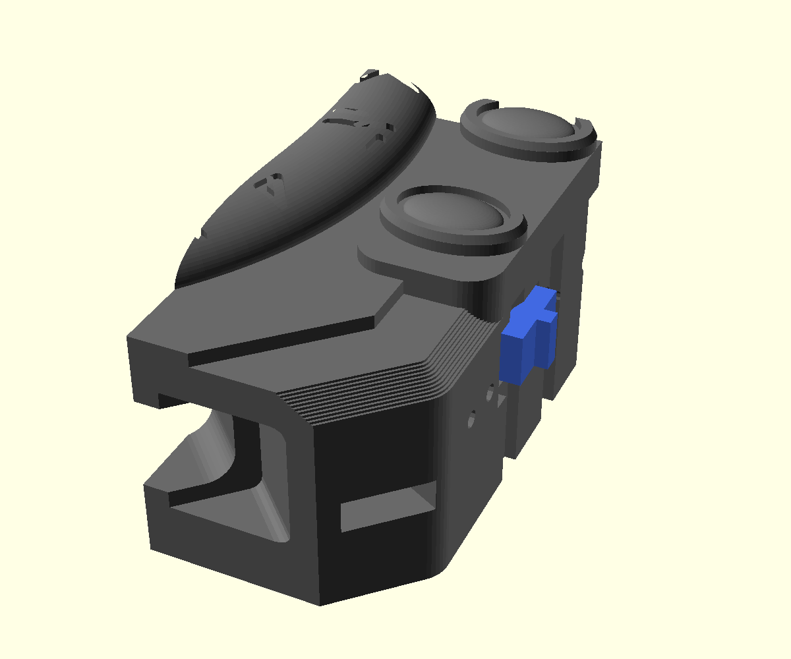

## Step 5: Connect and Insert the Battery

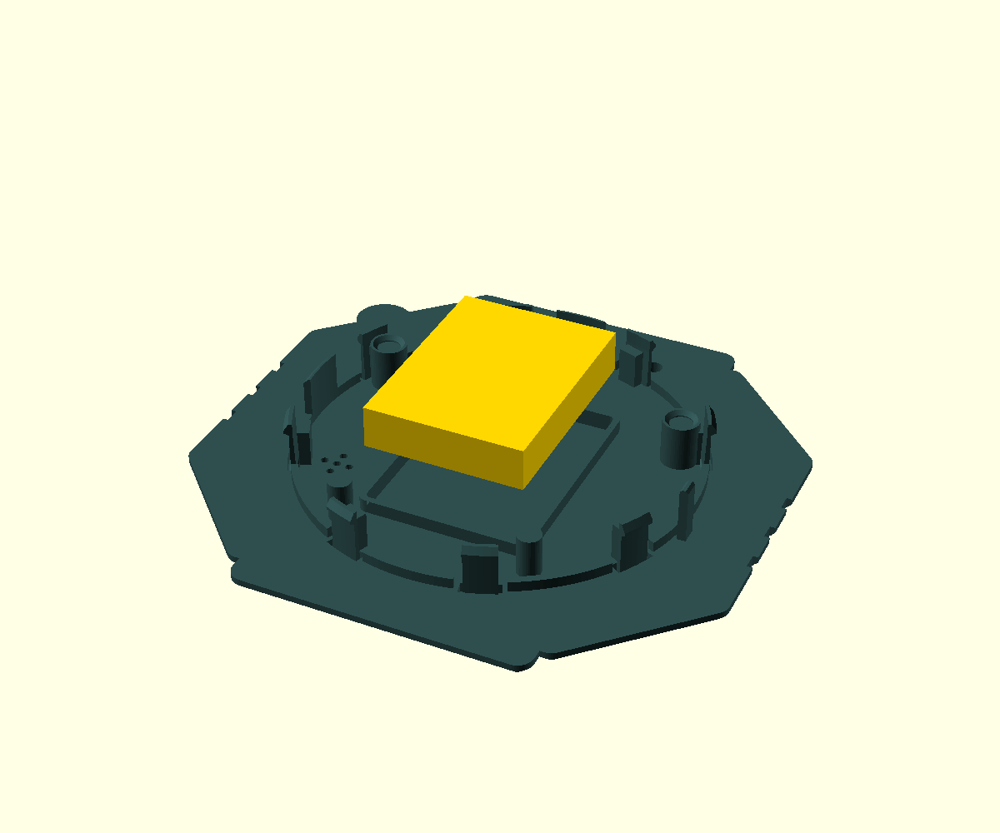

1. Measure the battery, including its protection board and tape: at most
   40.5 × 30.5 × 9.0 mm. A larger battery pushes the back cover open.
2. Plug the battery connector into the `BAT` socket; the socket faces the open back, and plus
   goes to the side marked +.
3. Place the battery in the frame in the back cover and run the cable through the gap at the
   top of the frame. Lay the spare cable over the battery, not along the edge: that is where
   the hooks flex inward when you close the case.

## Step 6: Put On the Back Cover

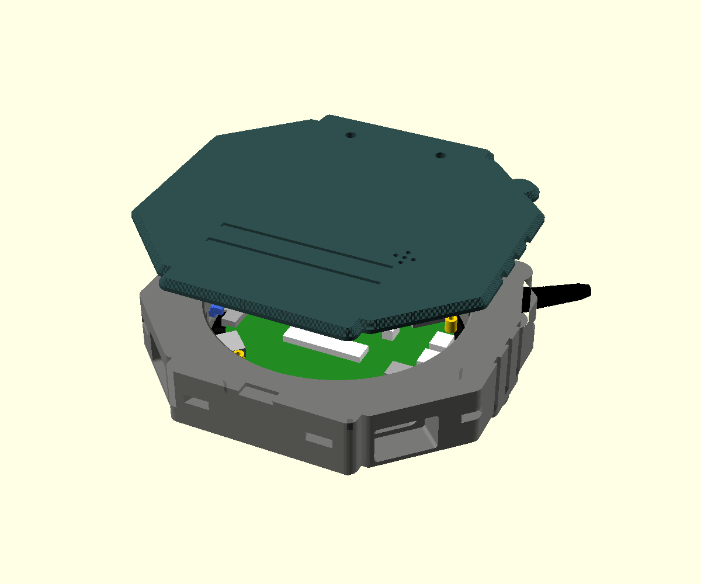

Hold the back cover with the battery level and set it onto the front so that the outlines line
up exactly.

- Two guides on the centering ring (top and left) enter the chamber first and line up the back
  cover before the hooks touch the edge.
- The tab at the right edge slides through the slot in the wall into the cross groove of the
  slider. The chamfers on the tab and the groove pull the slider into place.
- The cups on the two upper pillars grip the heads of the board’s standoffs and turn the board
  into position. After that, the board can no longer turn, and the slider switches reliably.

## Step 7: Snap It Shut

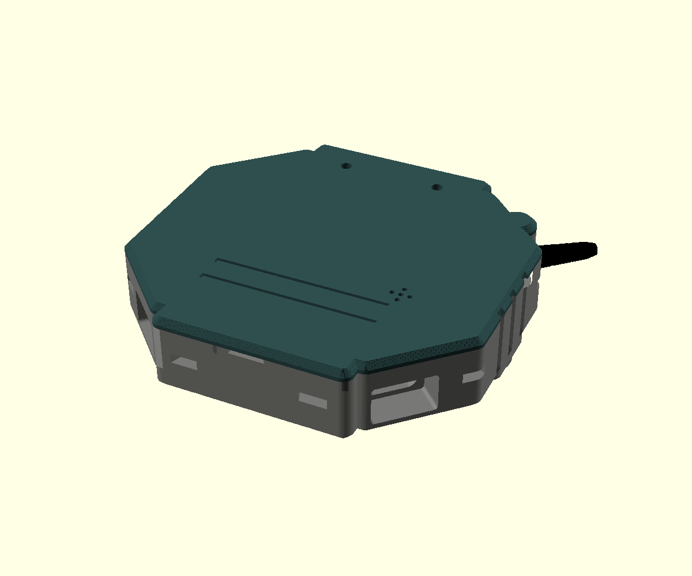

Press the flat of your hand on the middle of the back cover, straight down, until all eight
hooks click audibly into place, two each at the top, bottom, left and right. This takes only a
little force. Afterwards, the back cover lies flat all around. If it stays open on one side, do
not press harder: take the back cover off and check for support leftovers, the battery cable
and the slider position.

## Step 8: Attach the Clip (Optional)

| Clip from below | Above the holes | Attached |
|---|---|---|
| 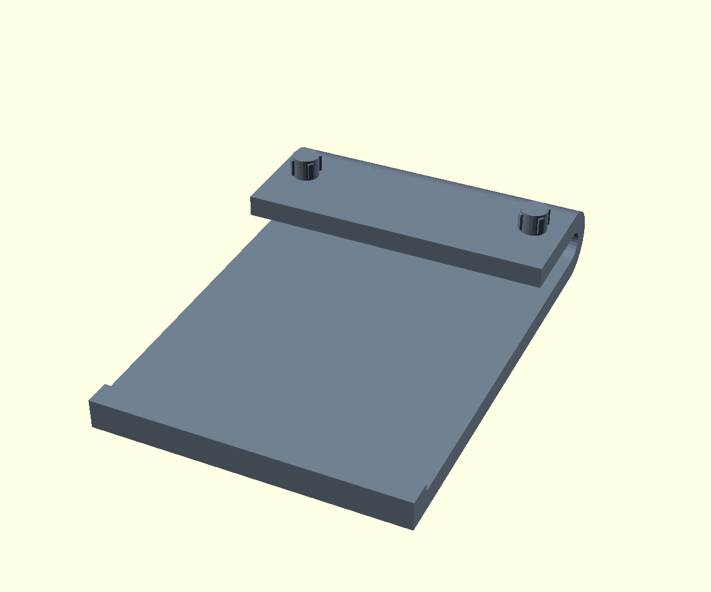 | 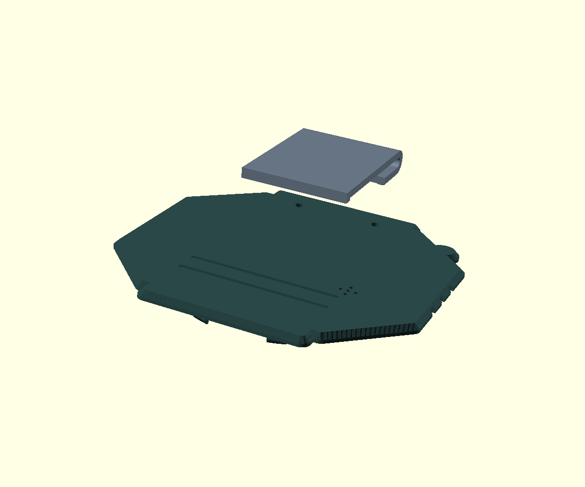 | 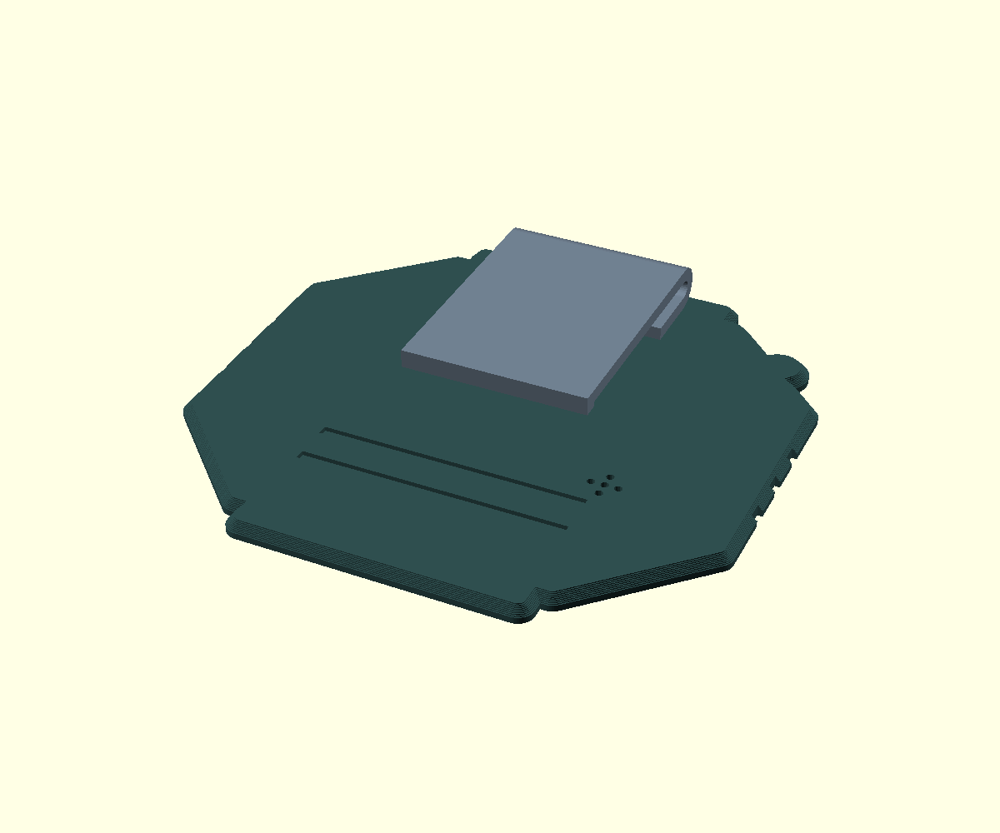 |

1. Hold the clip so that the bend points to the top edge of the back cover and the arm hangs
   down over the back.
2. Place the two pegs on the two holes above the cross grooves.
3. Press the base plate down with your thumb until it sits flat. The crush ribs on the pegs
   hold the clip. The pegs end inside the back cover, so the clip can also go on before you
   close the case.

To remove it, pull it straight off. If the clip is too tight to push on, ream the holes in the
back cover by hand with a 3.5 mm drill bit.

## Step 9: Switch On

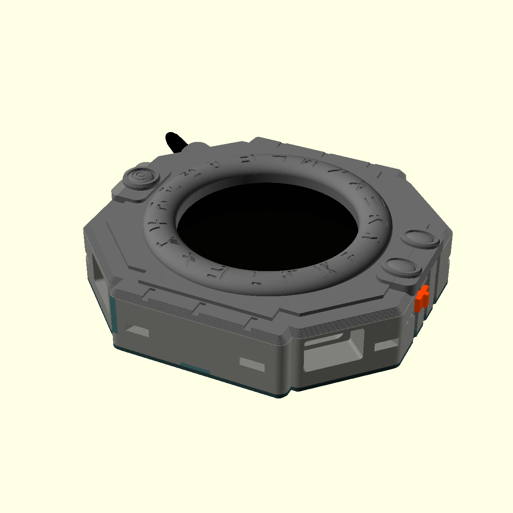

Slider up: the display turns on. Charge through the USB-C socket at the bottom right (seen from
the front); the UART port is at the bottom left. Press BOOT and RESET with a paper clip through
the two pinholes above the slider.

## Opening

You only need to open the case to replace the battery; flashing works over USB-C. The hooks
are PLA, so do not pry them.

1. Push a paper clip through a window in the wall and press the hook inward until it is free.
   A stop on the inside keeps it from bending too far.
2. At the same time, lift that side of the back cover at the notch on the bottom edge with
   your fingernail.
3. Go side by side like this: first the bottom, then left and right, the top last.

Then pull the slider out before you take out the board.
