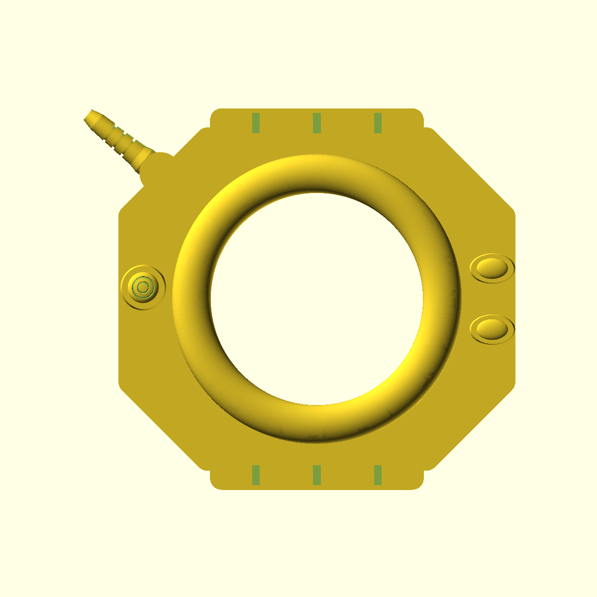
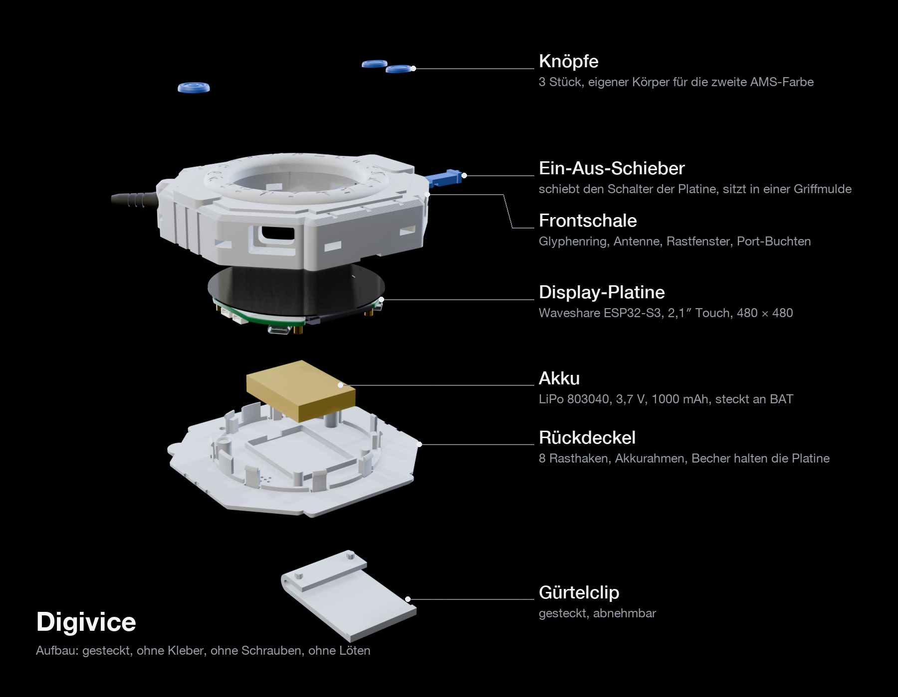
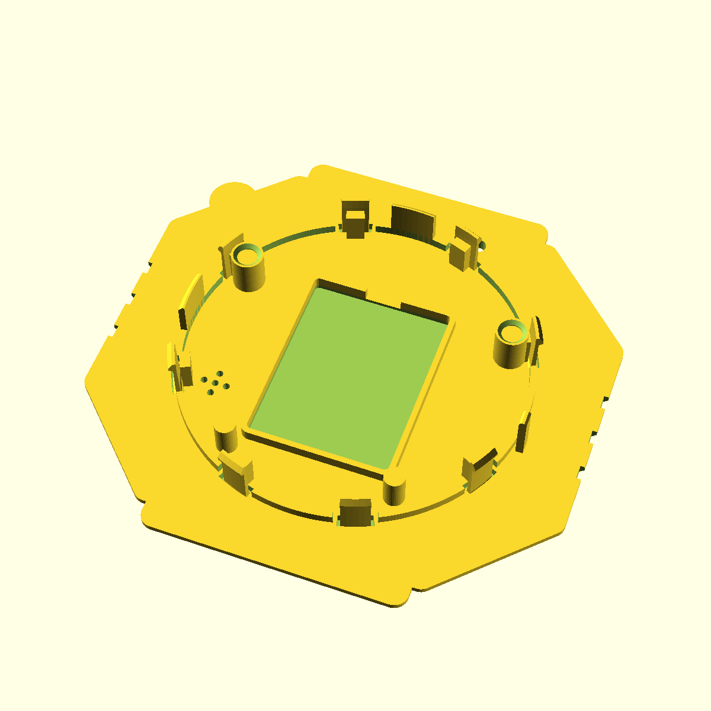
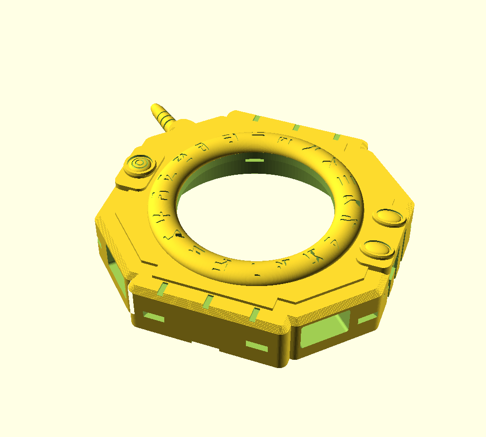
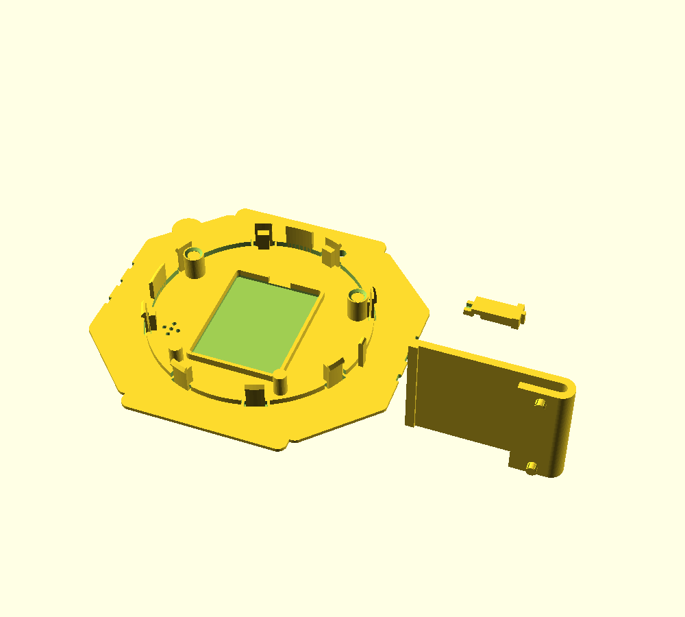

# Digivice-Gehäuse für Waveshare ESP32-S3-Touch-LCD-2.1

English: [README.md](README.md)

Ein druckbares Gehäuse im Stil des Digimon-Adventure-Digivice für das runde
Waveshare-Touch-Display (2,1″, 480 × 480) und einen LiPo-Akku. Alles wird gesteckt: kein
Kleber, keine Schrauben, kein Löten.

**Stand:** Version 1.2. Ein Probedruck von Version 1.2 steht noch aus.

Als Video: [reveal.mp4](media/reveal.mp4). Zusammenbau Schritt für Schritt mit Bildern:
[ANLEITUNG.md](ANLEITUNG.md).

| Vorderseite | Explosion | Rückdeckel innen |
|---|---|---|
|  |  |  |

Außenmaß ca. 113 × 100 × 27 mm mit Antenne, ohne Clip.

Dieses Repo enthält das Gehäuse: Druckdateien, Druckprofile, Anleitung und Animationen.
Firmware und CAD-Quellen gehören nicht dazu.

## Neu in Version 1.2

Eine Prüfung von Version 1.1 (Messungen an den Druckdateien, eine Festigkeitsrechnung der
Haken und Probe-Slices) fand Fehler, die das Schließen verhindert hätten. Version 1.2 behebt
sie:

- **Clip:** Die Zapfen enden jetzt im Deckel und stoßen nicht mehr an die Frontwand; der
  Deckel schließt auch mit aufgestecktem Clip. Der Arm ist voll breit und steht beim Druck auf
  der Druckplatte.
- **Rasthaken für PLA:** Eine Tasche im Deckel verlängert jeden Haken, der Haken wird zur
  Spitze hin dünner, Wurzel und Nase sind verrundet. Rechnerisch braucht das Einrasten aller
  acht Haken 30–50 N statt 170–280 N, gehalten wird der Deckel mit 44–89 N. Anschläge innen
  verhindern, dass ein Haken beim Öffnen überbogen wird.
- **Ausrichten:** Zwei Führungen am Zentrierring richten den Deckel aus, bevor die Haken die
  Kante berühren. Eine Fase an der Kammeröffnung fängt Zentrierring und Elefantenfuß.
- **Platine:** Becher auf den oberen Säulen fassen die Bolzenköpfe der Platine. Sie kann sich
  nicht mehr verdrehen, der Schieber schaltet, statt die Platine zu drehen.
- **Schieber:** Der Griff schlägt am Boden der Griffmulde an und rutscht nicht mehr in den
  Kanal. Fasen an Steg und Nut fangen beim Schließen einen Versatz von ±1,35 mm statt
  ±0,35 mm.
- **Druck:** 45°-Dächer über Griffmulde und Schieberkanal, unter 45° auslaufende Kerben am
  Rand: An den Flanken, in den Rastfenstern und im Schieberkanal entstehen keine Stützen mehr.
  Platte 2 braucht gar keine Stützen.

## Was du brauchst

| Teil | Menge | Quelle |
|---|---|---|
| Waveshare ESP32-S3-Touch-LCD-2.1 (flache Variante) | 1 | Amazon, ASIN B0DDPQSKJD |
| LiPo 803040, 3,7 V, 1000 mAh, 1,25-mm-Stecker, mit Schutzschaltung | 1 | Amazon, ASIN B0DPZNZ4D6 |
| PLA-Filament, alle Teile | ca. 100 g | |

Werkzeug: Seitenschneider oder Zange für die Stützen, ein Messschieber für den Akku, eine
Büroklammer für BOOT und RESET.

Der Akkustecker passt direkt in die Buchse `BAT` der Platine. Der Akku darf samt Schutzplatine
und Klebeband höchstens 40,5 × 30,5 × 9,0 mm messen. Ein- und ausgeschaltet wird mit einem
gedruckten Schieber an der rechten Flanke, der den Schalter der Platine bedient. Ein
zusätzlicher Schalter ist nicht nötig.

## Druckdateien

| Datei | Inhalt | Druck |
|---|---|---|
| `stl/front_multicolor.stl` | Frontschale; Gehäuse, drei Knöpfe und Antenne als getrennte Körper (AMS) | Gesicht oben, normale Stützen, Stil „Nahtlos“, nur auf der Druckplatte |
| `stl/front_single_color.stl` | dieselbe Front als ein Körper | wie oben |
| `stl/back_clip_slider.stl` | Rückdeckel, Gürtelclip und Ein-Aus-Schieber auf einer Platte | ohne Stützen |
| `stl/single/back.stl`, `clip.stl`, `slider.stl` | dieselben Teile einzeln, zum Nachdrucken | ohne Stützen |

Beide Platten passen auf 180 × 180 mm.

| Platte 1 | Platte 2 |
|---|---|
|  |  |

## Drucken

- **Material:** PLA für alle Teile, auch für Deckel und Rasthaken.
- **Schichthöhe:** 0,16 mm, für scharfe Glyphen und gleichmäßige Haken.
- **Platte 1 (Front):** **normale** Stützen, Typ „Normal (auto)“, Stil „Nahtlos“ (in der
  englischen Oberfläche „Snug“), „Nur auf Druckplatte“, Schwellenwinkel 30°. Keine
  Baumstützen: Sie wachsen von außen in die acht Rastfenster, und Reste dort blockieren später
  die Haken.
- **Platte 2 (Deckel, Clip, Schieber):** keine Stützen. Auch der Arm des Clips steht auf der
  Druckplatte.

Die Front braucht Stützen nur in der Kammer unter der Frontplatte, wo später das Displayglas
liegt, unter der Antenne und in der Hebelkerbe an der Unterkante. Rastfenster, Schieberkanal
und Flanken bleiben frei.

### Profile für Bambu Studio (P1S)

In `bambu-p1s/` liegen fertige Profile für den Drucker „Bambu Lab P1S 0.4 nozzle“. In Bambu
Studio den P1S mit 0,4-mm-Düse auswählen und über **Datei > Importieren > Konfigurationen
importieren …** alle drei Dateien laden.

| Profil | Art | für | Einstellungen |
|---|---|---|---|
| `Digivice Front 0.16mm` | Prozess | Platte 1 | normale Stützen, Stil „Nahtlos“, nur auf der Druckplatte, 30°, 3 Schnittstellenschichten; 3 Wände, 15 % Gyroid; erste Schicht 10 mm/s; Elefantenfuß 0,15 mm |
| `Digivice Back 0.16mm` | Prozess | Platte 2 | keine Stützen; 4 Wände, 100 % Füllung (Zick-Zack), damit die Hakenwurzeln in vollem Material sitzen; erste Schicht 10 mm/s, innere Wände 100 mm/s; Elefantenfuß 0,15 mm |
| `Digivice PLA Back` | Filament | Platte 2 | 230 °C, Lüfter 40–70 %, Zusatzlüfter 30 %: bessere Schichthaftung in den Rasthaken |

Die Front druckst du mit einem PLA-Systemprofil, z. B. „Bambu PLA Basic“ oder „Generic PLA“.
Beide Prozessprofile bauen auf „0.16mm High Quality @BBL X1C“ auf (0,16 mm Schichthöhe) und
nutzen Arachne-Wände mit „Präzise Wand“.

Richtwerte aus einem Probe-Slice von Version 1.2 mit Bambu Studio 2.8, gemessen auf einem P1S
mit eigenem Start-G-Code. Auf dem Standard-P1S sind die Werte noch nicht nachgemessen und
können etwas abweichen. Der Probe-Slice lief ohne Warnungen.

| Platte | Profile | Zeit | Filament |
|---|---|---|---|
| 1 | `Digivice Front 0.16mm` + PLA-Systemprofil | ca. 3 h 20 min | ca. 62 g |
| 2 | `Digivice Back 0.16mm` + `Digivice PLA Back` | ca. 2 h 10 min | ca. 39 g |

**Anderer Drucker oder Slicer:** Die Tabelle nennt die wichtigsten Werte. Die JSON-Dateien in
`bambu-p1s/` enthalten jede Einstellung, die vom Grundprofil abweicht.

### Mehrfarbig mit AMS

1. `stl/front_multicolor.stl` in Bambu Studio oder OrcaSlicer laden.
2. Rechtsklick auf das Objekt, **Teilen > Zu Teilen**. Es entstehen genau fünf Teile:
   Gehäuse, drei Knöpfe, Antenne.
3. Jedem Teil in der Objektliste ein Filament zuweisen.

Die Knöpfe liegen in den obersten rund 12 Schichten, dort kostet der Farbwechsel wenig. Die
Antenne reicht über rund 37 Schichten in der Mitte der Front; eine eigene Antennenfarbe
bedeutet dort je zwei Farbwechsel pro Schicht. Wer Spülmaterial sparen will, gibt der Antenne
die Gehäusefarbe. Den Schieber gibt es auf Platte 2, er passt gut in der Knopffarbe.

## Bedienung

- **Ein/Aus:** Schieber an der rechten Flanke nach oben ist EIN, nach unten AUS. Der Griff
  sitzt in einer Mulde und hat eine Rippe für den Fingernagel.
- **Laden:** USB-C unten rechts (von vorn gesehen). Unten links liegt der UART-Port.
- **BOOT und RESET:** mit einer Büroklammer durch die zwei Nadellöcher oberhalb des Schiebers.
- **TF-Karte:** Schlitz oben links.
- **Öffnen:** Haken mit einer Büroklammer durch die Fenster lösen und den Deckel an der Kerbe
  unten anheben, siehe [ANLEITUNG.md](ANLEITUNG.md#öffnen). Die Haken aus PLA nicht hebeln.

## Film

[digivice_film.mp4](media/digivice_film.mp4): 90 Sekunden, 1080p, mit Musik.

Music: “Go Cart” Kevin MacLeod (incompetech.com)\
Licensed under Creative Commons: By Attribution 4.0 License\
http://creativecommons.org/licenses/by/4.0/\
Ausschnitt, gekürzt und ein- und ausgeblendet, zum Bild synchronisiert.

Die Videodatei trägt dieselbe Angabe in ihren Metadaten.

## Lizenz und Quellen

- Die eigenen Inhalte dieses Projekts (Druckdateien, Profile, Bilder, Animationen, Film und
  Texte): [CC BY-NC-SA 4.0](LICENSE). Die Lizenz gilt nur für diese eigenen Inhalte und räumt
  keine Rechte an Figuren, Namen, Designs oder Modellen Dritter ein, siehe unten.
- Musik im Film: CC BY 4.0, siehe [Film](#film).
- Vorbilder für Form und Proportionen:
  [„Digivice from Digimon“](https://pinshape.com/items/43091-digivice-from-digimon) von Devin
  Gentner (CC BY-NC-SA 4.0) und
  [„digivice removable back“](https://www.thingiverse.com/thing:2754641) von jpek13 (CC BY-SA).
  Keine Dateien oder Geometrie daraus übernommen; das Gehäuse ist von Grund auf in OpenSCAD
  modelliert.
- Platine: Maße aus dem STEP-Modell und der Maßzeichnung des Waveshare ESP32-S3-Touch-LCD-2.1.
  Die Platine in den Renderbildern, Animationen und im Film beruht auf diesem STEP-Modell
  (© Waveshare, nicht Teil dieser Lizenz).
- Digivice und Digimon sind Marken von Bandai. Digimon und seine Figuren, auch Agumon:
  © Akiyoshi Hongo, Toei Animation. Die Pixelfigur auf dem Display in den Animationen und im
  Film ist Fan-Art. Fanprojekt, nicht mit Bandai oder Toei Animation verbunden und nicht von
  ihnen unterstützt.
