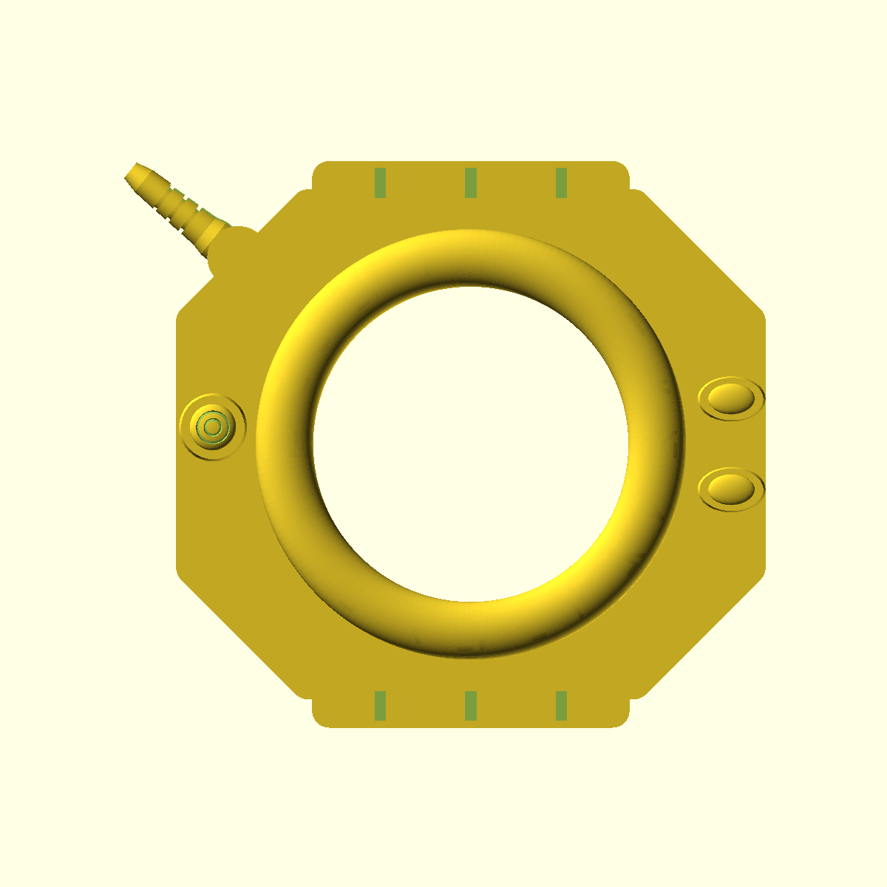
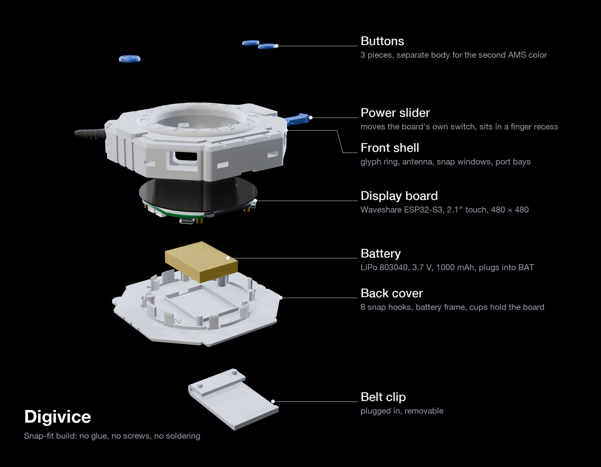
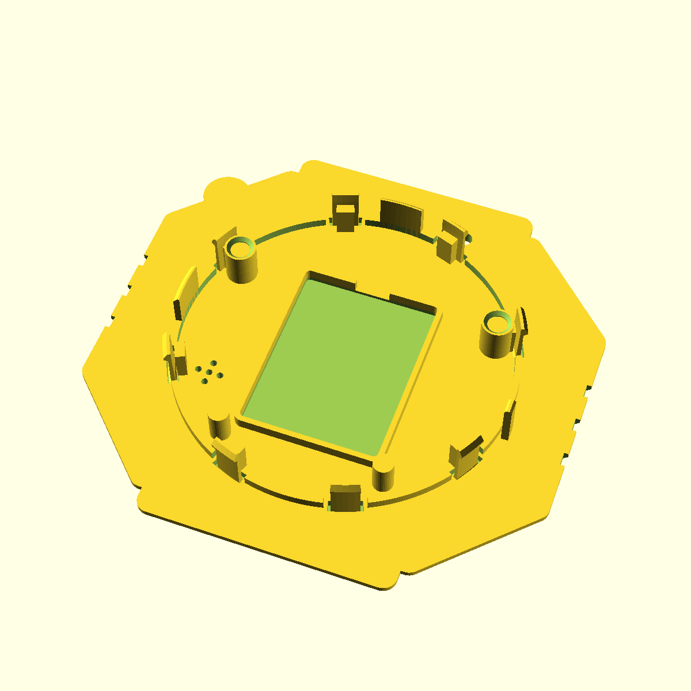
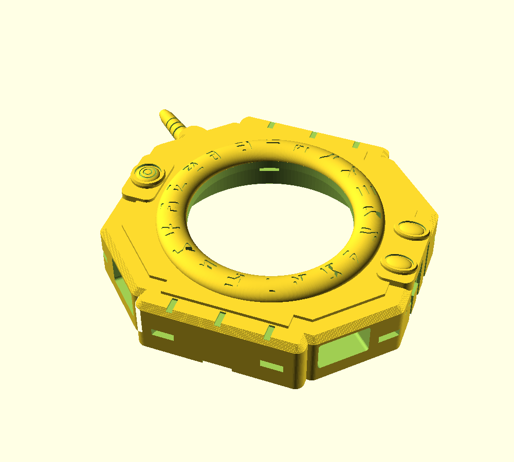
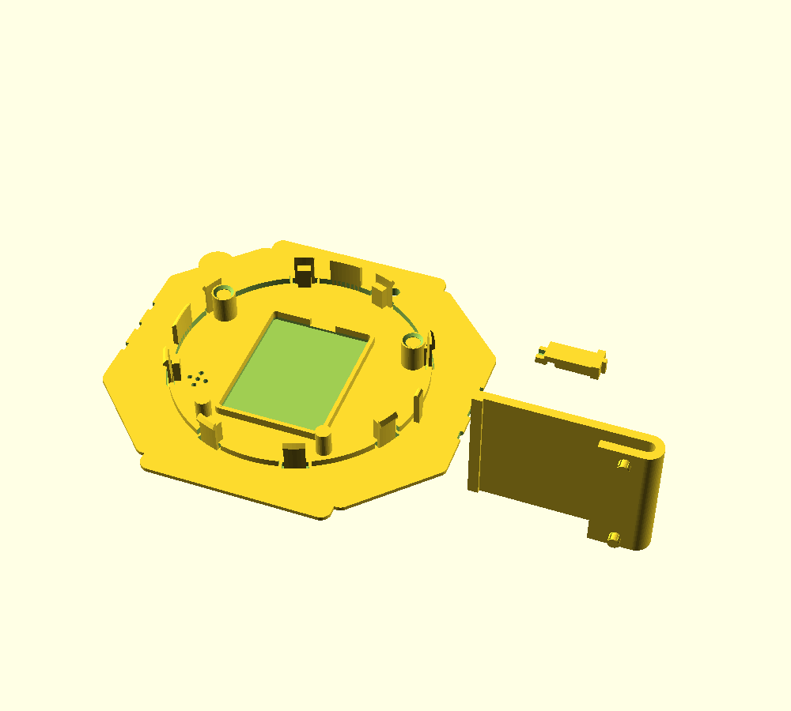

# Digivice Case for the Waveshare ESP32-S3-Touch-LCD-2.1

Deutsch: [README.de.md](README.de.md)

A printable case in the style of the Digimon Adventure Digivice for the round Waveshare touch
display (2.1″, 480 × 480) and a LiPo battery. Everything snaps or plugs together: no glue, no
screws, no soldering.

**Status:** Version 1.2. A test print of version 1.2 is still pending.

As a video: [reveal.mp4](media/reveal.mp4). Step-by-step assembly with pictures:
[ASSEMBLY.md](ASSEMBLY.md).

| Front | Exploded view | Back cover, inside |
|---|---|---|
|  |  |  |

Outer dimensions about 113 × 100 × 27 mm including the antenna, without the clip.

This repository contains the case: print files, print profiles, assembly guide and
animations. Firmware and CAD sources are not included.

## New in Version 1.2

A review of version 1.1 (measurements on the print files, a strength calculation of the hooks
and test slices) found flaws that would have kept the case from closing. Version 1.2 fixes
them:

- **Clip:** the pegs now end inside the back cover and no longer hit the front wall; the back
  cover closes with the clip attached, too. The arm is full width and stands on the build plate
  while printing.
- **Snap hooks for PLA:** a pocket in the back cover makes each hook longer, the hook gets
  thinner towards its tip, and its root and nose are rounded. By calculation, snapping all
  eight hooks shut takes 30–50 N instead of 170–280 N, and they hold the back cover with
  44–89 N. Stops on the inside keep a hook from bending too far when you open the case.
- **Alignment:** two guides on the centering ring line up the back cover before the hooks
  touch the edge. A chamfer on the chamber opening catches the centering ring and any elephant
  foot.
- **Board:** cups on the upper pillars grip the heads of the board’s standoffs. The board can
  no longer turn, so the slider switches instead of turning the board.
- **Slider:** the grip stops against the bottom of its recess and no longer slips into the
  channel. Chamfers on the tab and the groove catch an offset of ±1.35 mm instead of ±0.35 mm
  when you close the case.
- **Printing:** 45° roofs over the grip recess and the slider channel, and notches on the rim
  that run out at 45°: no more supports on the flanks, in the snap windows or in the slider
  channel. Plate 2 needs no supports at all.

## What You Need

| Part | Qty | Source |
|---|---|---|
| Waveshare ESP32-S3-Touch-LCD-2.1 (flat version) | 1 | Amazon, ASIN B0DDPQSKJD |
| LiPo 803040, 3.7 V, 1000 mAh, 1.25 mm connector, with protection circuit | 1 | Amazon, ASIN B0DPZNZ4D6 |
| PLA filament, all parts | about 100 g | |

Tools: side cutters or pliers for the supports, a caliper for the battery, a paper clip for
BOOT and RESET.

The battery connector plugs straight into the board’s `BAT` socket. Including its protection
board and tape, the battery must not exceed 40.5 × 30.5 × 9.0 mm. You switch the device on and
off with a printed slider on the right flank that moves the board’s own switch. No extra switch
is needed.

## Print Files

| File | Contents | Printing |
|---|---|---|
| `stl/front_multicolor.stl` | Front shell; body, three buttons and antenna as separate bodies (AMS) | Face up, normal supports, style “Snug”, on build plate only |
| `stl/front_single_color.stl` | The same front as one body | As above |
| `stl/back_clip_slider.stl` | Back cover, belt clip and power slider on one plate | No supports |
| `stl/single/back.stl`, `clip.stl`, `slider.stl` | The same parts one by one, for reprints | No supports |

Both plates fit on a 180 × 180 mm bed.

| Plate 1 | Plate 2 |
|---|---|
|  |  |

## Printing

- **Material:** PLA for all parts, including the back cover and its snap hooks.
- **Layer height:** 0.16 mm, for crisp glyphs and even hooks.
- **Plate 1 (front):** **normal** supports, type “normal(auto)”, style “Snug” (“Nahtlos” in
  the German interface), on build plate only, threshold angle 30°. No tree supports: they grow
  into the eight snap windows from outside, and leftovers there block the hooks later.
- **Plate 2 (back cover, clip, slider):** no supports. The clip’s arm stands on the build
  plate, too.

The front needs supports in three places only: in the chamber under the front plate (the
display glass sits there later), under the antenna and in the pry notch at the bottom edge.
The snap windows, the slider channel and the flanks stay clear.

### Profiles for Bambu Studio (P1S)

`bambu-p1s/` contains ready-made profiles for the “Bambu Lab P1S 0.4 nozzle” printer. In
Bambu Studio, select the P1S with the 0.4 mm nozzle and load all three files with
**File > Import > Import Configs…**.

| Profile | Type | For | Settings |
|---|---|---|---|
| `Digivice Front 0.16mm` | Process | Plate 1 | Normal supports, style “Snug”, on build plate only, 30°, 3 interface layers; 3 walls, 15% gyroid infill; first layer 10 mm/s; elephant foot compensation 0.15 mm |
| `Digivice Back 0.16mm` | Process | Plate 2 | No supports; 4 walls, 100% zig-zag infill, so the hook roots sit in solid material; first layer 10 mm/s, inner walls 100 mm/s; elephant foot compensation 0.15 mm |
| `Digivice PLA Back` | Filament | Plate 2 | 230 °C, fan 40–70%, aux fan 30%: better layer adhesion in the snap hooks |

Print the front with any PLA system profile, for example “Bambu PLA Basic” or “Generic PLA”.
Both process profiles are based on “0.16mm High Quality @BBL X1C” (0.16 mm layers) and use
Arachne walls with “Precise wall”.

Approximate values from a test slice of version 1.2 in Bambu Studio 2.8, measured on a P1S
with a custom start G-code. They have not been re-measured on the stock P1S yet and may differ
slightly. The test slice showed no warnings.

| Plate | Profiles | Time | Filament |
|---|---|---|---|
| 1 | `Digivice Front 0.16mm` + a PLA system profile | about 3 h 20 min | about 62 g |
| 2 | `Digivice Back 0.16mm` + `Digivice PLA Back` | about 2 h 10 min | about 39 g |

**Other printer or slicer:** the table lists the main settings. The JSON files in `bambu-p1s/`
contain every setting that differs from the base profile.

### Multicolor with AMS

1. Load `stl/front_multicolor.stl` in Bambu Studio or OrcaSlicer.
2. Right-click the object and choose **Split > To parts**. You get exactly five parts: body,
   three buttons, antenna.
3. Assign a filament to each part in the object list.

The buttons sit in the top 12 or so layers, where a color change costs little. The antenna
spans about 37 layers in the middle of the front, so a separate antenna color means two color
changes per layer there. To save purge material, give the antenna the body color. The slider
is on plate 2 and looks good in the button color.

## Operation

- **On/off:** push the slider on the right flank up for ON, down for OFF. The grip sits in a
  recess and has a rib for your fingernail.
- **Charging:** USB-C at the bottom right (seen from the front). The UART port is at the
  bottom left.
- **BOOT and RESET:** press them with a paper clip through the two pinholes above the slider.
- **TF card:** slot at the top left.
- **Opening:** release the hooks with a paper clip through the windows and lift the back cover
  at the notch at the bottom, see [ASSEMBLY.md](ASSEMBLY.md#opening). Do not pry the PLA hooks.

## Film

[digivice_film.mp4](media/digivice_film.mp4): 90 seconds, 1080p, with music.

Music: “Go Cart” Kevin MacLeod (incompetech.com)\
Licensed under Creative Commons: By Attribution 4.0 License\
http://creativecommons.org/licenses/by/4.0/\
Excerpt, cut and faded, synchronized to the film.

The video file carries the same credit in its metadata.

## License and Credits

- This project’s own work (print files, profiles, images, animations, film and texts):
  [CC BY-NC-SA 4.0](LICENSE). The license covers only this project’s own work. It grants no
  rights to third-party characters, names, designs or models, see below.
- Music in the film: CC BY 4.0, see [Film](#film).
- Inspiration for shape and proportions:
  [“Digivice from Digimon”](https://pinshape.com/items/43091-digivice-from-digimon) by Devin
  Gentner (CC BY-NC-SA 4.0) and
  [“digivice removable back”](https://www.thingiverse.com/thing:2754641) by jpek13 (CC BY-SA).
  No files or geometry from these models were used; the case was modeled from scratch in
  OpenSCAD.
- Board: dimensions from the STEP model and dimension drawing of the Waveshare
  ESP32-S3-Touch-LCD-2.1. The board shown in the renders, animations and film is based on
  that STEP model (© Waveshare, not covered by this license).
- Digivice and Digimon are trademarks of Bandai. Digimon and its characters, including Agumon:
  © Akiyoshi Hongo, Toei Animation. The pixel figure on the display in the animations and the
  film is fan art. This is a fan project, not affiliated with or endorsed by Bandai or Toei
  Animation.
